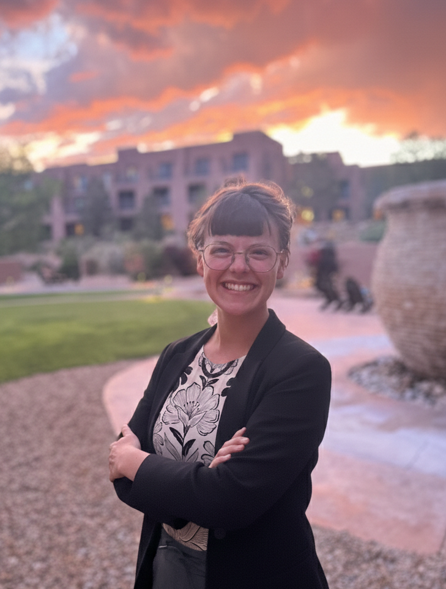

  

    <h2>About Brooke</h2>
    
I’m a Ph.D. candidate in my fifth year in Agricultural and Resource Economics Department at Colorado State University. I received my bachelors degree in Data Science and Applied Mathematics and worked as a data scientist for three years before beginning my Ph.D. I am currently a NASA FINESST fellow.

    
My research combines data science and environmental economics to study the interactions between pollution, environmental change, and humanity. I use machine learning, satellite imagery, and big data to answer important and policy relevant questions. My current work includes using satellite and mobility data to measure the economic costs of wildfire smoke and using machine learning to fill global data gaps in smoke pollution exposure. To learn more, take a look at my <a href="https://brookefitzgerald.com/research/">research page</a> or <a href="https://brookefitzgerald.com/cv/">CV</a>.

    
I’m also committed to making economics more inclusive, serving as a graduate liaison for the Women in Economics group and representing students in my department. Through research and outreach, I aim to inform equitable, data-driven environmental policy.

    

      <a href="mailto:brooke.fitzgerald@colostate.edu" class="contact-link">Get in touch <i class="fas fa-envelope"></i></a>
      brooke.fitzgerald(at)colostate(dot)edu
    

  

  

    
  

