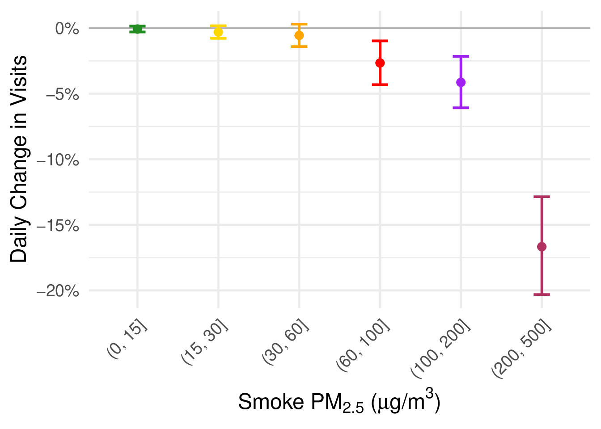
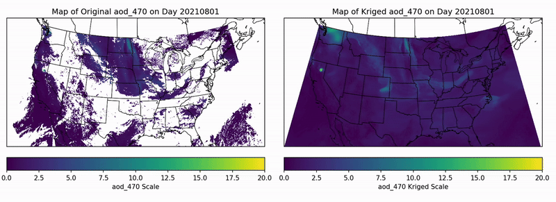
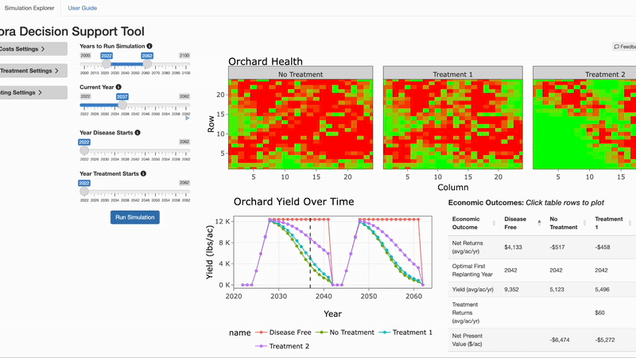

## Working Papers

  
<strong>The Price of Staying In: Estimating Wildfire Smoke Avoidance Costs Using Comprehensive US Mobility and Spending Data.</strong>

  
With Jude Bayham, Alexandra Hill, and Jesse Burkhardt

  
<a href="https://brookefitzgerald.com/files/Avoidance_Paper_draft_10_2026.pdf">Draft</a>|Submitted

  

    
Abstract

    

      

        
Wildfire smoke is reversing decades of air quality improvements in the United States. We use variation in plausibly random wildfire smoke exposure combined with nationwide mobility and consumer spending data to estimate the welfare costs of smoke avoidance behavior. We find that severe smoke episodes reduce foot traffic to local businesses by 3-17% and decrease deferrable consumer spending by $39,000-$243,000 per county per day. This translates to welfare effects of $477-$18,383 per county per day, equivalent to 10% of the daily health costs on the most severe day. We find that avoidance increases with smoke intensity and that people do not simply reallocate spending across space and time. Public health guidance encourages avoidance behavior as a way to reduce smoke exposure. As climate-driven wildfire activity and associated smoke exposure continue to increase, our results highlight the economic consequences of people's protective decisions.

      

      <figure class="paper__figure">
        
        <figcaption>Daily change in visits to local businesses by smoke PM2.5 concentration, with 95% confidence intervals.</figcaption>
      </figure>
    

  

  
<strong>Measuring Wildfire Smoke and PM2.5: Implications for Estimates of Economic Damages.</strong>

  
With Jesse Bukhardt, Alexandra Hill, and Jude Bayham

  
Draft available upon request

  

    
Abstract

    

      

        
Identifying the economic effects of air pollution requires careful measurement of exposure, especially when separating wildfire smoke from emissions tied to economic activity. In this paper, we evaluate four air pollution and smoke measurements: ground-monitor readings, satellite smoke maps, gridded predictions of ground-level smoke PM2.5 (fine-particle pollution), and simulated smoke transport. We compare these measures in two national replications including the earnings analysis of Borgschulte et al. (2024) and the daily violent-crime analysis of Burkhardt et al. (2019) and produce four key takeaways. First, replacing satellite smoke-day counts (e.g., HMS) with modeled ground-level smoke reduces estimated earnings losses at average exposure by 72–81%. Second, light or thin satellite-detected plumes are associated with the smallest increases in surface-level monitored pollution and the largest estimated earnings losses per unit of pollution. The earnings relationship estimated using only satellite-detected smoke within the atmospheric column persists when a surface model reports zero smoke, implying smoke aloft is driving the earnings relationship. Third, gridded smoke estimates depend on assumptions about background pollution—the pollution expected without wildfire smoke. Changing the background pollution assumptions can reduce estimated earnings losses by 77–86% and estimated increases in violent crime by 95–98%, evaluated at the average smoke exposure assigned under each definition. Fourth, simulations holding the economic response to smoke fixed show that stricter surface smoke definitions that remove more endogenous pollution can substantially reduce estimated impacts by attributing less pollution to smoke. Researchers’ choices about exposure measurement and background pollution consequently have substantial implications for estimates of air pollution’s economic costs.

      

    

  

## Works in Progress

  
<strong>Is that Smoke in the Air? Estimating the Global Economic Cost of Smoke Exposure.</strong>

  
With Jesse Burkhardt, Kimberly Corwin, Yawen Guan, Emily Fischer, and Jeffrey Pierce

  
<strong>Estimating the Dual Impact of Smoke Exposure on Global Crop Yields Using Machine Learning</strong>

  
With Jesse Burkhardt, Kimberly Corwin, Yawen Guan, Emily Fischer, and Jeffrey Pierce

  
<strong>Firefighter Retention: Evidence from Administrative Earnings and Employment Data</strong>

  
With Jude Bayham, Judhajit Chakraborty, and Alisha Sharma

## Extras

Due to cloud cover, satellite data often has missing data. To use algorithms that take spatial information into account requires filling in that missing data. This gif is the result of interpolating aerosol optical depth using Deep Kriging - a method that fits a smooth surface to data from non-linear combination of spatial basis functions with deep learning.

Collaborating with plant pathologist Dr. Jane Stewart and agricultural economist Dr. Dana Hoag, I developed a tool that simulates the probabalistic spread of a disease in an orchard using Monte Carlo simulation, while also allowing users to explore the underlying simulation logic. The tool is publically available at [orcharddiseasetool.net](https://bfit.shinyapps.io/cytospora/).
